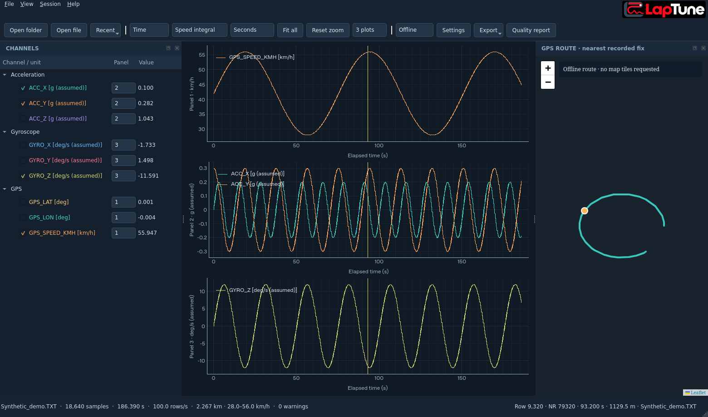

# Telemetry Viewer · LapTune

A local Python/Qt desktop viewer for STM32 IMU/GPS logs, targeting Windows 10/11 x64.
English UI, dark panels, interactive time/distance plots and a synchronized GPS route.
No backend service; raw logs stay on your computer.



## Current implementation

- Single-file or whole-folder semicolon TXT import in a Qt worker with progress,
  numeric filename ordering, source-file diagnostics and preserved
  acquisition order, raw date/time and point-corrected monotonic display time.
- Generic numeric channels, individual channel time arrays, validity and source metadata.
  No fixed IMU/GPS refresh frequency is assumed. An unknown numeric column appears automatically.
- Up to four linked PyQtGraph panels, channel checkboxes/panel assignment, solo mode,
  nearest recorded value readout, shared cursor, wheel/pan/rectangle zoom and fit all.
- Time or distance axes without reimporting. Compare speed-integrated and GPS-geodesic distance.
- Bundled Leaflet 1.9.4 with Qt WebChannel, route/marker, map-to-plot selection and offline mode.
  Optional licensed satellite tile template; no provider key is required for Road or Offline.
- CSV of selected channels plus JSON metadata, and GPX of accepted GPS changes.
- Recent files, dock layout, metadata and map settings saved locally with QSettings.
- PyInstaller onedir spec and GitHub Actions jobs for source tests, Windows packaging and a
  smoke test of the **actual frozen Windows executable**, including WebEngine resources.

**Validation status:** local source tests and offline GUI smoke cover both single-file and
folder import. The initial Windows source tests, frozen EXE smoke and ZIP packaging passed in
[GitHub Actions](https://github.com/Paddy625/LapTune_App/actions/runs/41229959076).
For later changes, use the Actions run for the commit you download. The private LOG0023.TXT
integration test is optional and excluded from Git. See [validation results](docs/validation.md).

## Windows PowerShell · VS Code

Use Python 3.12 x64 (Python 3.11+ is supported by the project). From the checkout:

```powershell
code .
py -3.12 -m venv .venv
.\.venv\Scripts\python.exe -m pip install -e ".[dev]" -c constraints.txt
.\.venv\Scripts\python.exe -m telemetry_viewer
.\.venv\Scripts\python.exe -m telemetry_viewer tests\fixtures\synthetic.TXT
```

In VS Code, run **Python: Select Interpreter**, choose `.venv\Scripts\python.exe`, then F5.
A launch configuration and recommended Python/Ruff extensions are included.
No PowerShell activation or execution-policy change is necessary.

Open one file using Ctrl+O, or choose **File > Open folder…** / **Ctrl+Shift+O** to read all
TXT files directly in a selected folder. You can also drop a folder onto the window or open it
from the command line:

```powershell
.\.venv\Scripts\python.exe -m telemetry_viewer "C:\Logs\Drive"
```

Files are read in ascending numerical filename order, e.g. `LOG2.txt`, `LOG003.TXT`, `LOG10.txt`.
Extensions are case-insensitive. Subfolders are not traversed. If a name contains several number
groups, they are compared from left to right; ties use the filename. Names without numbers follow
numbered files alphabetically. Every TXT file needs its own logger header and usable data rows.
An empty or incompatible file aborts the import with its name, leaving the previous session open.

The folder becomes one session: raw timestamps and row order are retained, while the time axis,
GPS changes and both distances are calculated across file boundaries. Missing optional channels
are marked invalid in the affected rows. The cursor shows the source filename; the quality report
lists files in order and identifies warnings by filename and physical line. CSV adds `source_file`
and `source_line`, and GPX includes them as extensions. Export cannot overwrite an input log.
Folder imports use the same background worker and can be reopened from Recent files and folders.

For the optional real-data integration test,
put the original file at `data/local/LOG0023.TXT`. That directory and TXT logs under `data/`
are ignored by Git. Never add private logs using `git add -f`.

Generate a larger, entirely synthetic demonstration with variable GPS refresh rates:

```powershell
.\.venv\Scripts\python.exe tools\generate_demo.py data\generated\demo.TXT
.\.venv\Scripts\python.exe -m telemetry_viewer data\generated\demo.TXT
```

## Tests and lint

```powershell
.\.venv\Scripts\python.exe -m pytest -q
.\.venv\Scripts\python.exe -m ruff check .
.\.venv\Scripts\python.exe -m ruff format --check .
.\.venv\Scripts\python.exe -m telemetry_viewer --smoke-test tests\fixtures\synthetic.TXT
```

The GUI smoke checks asynchronous import, plotted sample count, both axes, a local Leaflet
route/marker and both directions of the WebChannel bridge. It uses synthetic data and Offline
mode. The optional private-log test skips when the file is absent. Tests do not contact tile servers.
The Linux CI subprocess uses offscreen software rendering and disables the Chromium sandbox
**only for the isolated test subprocess**. The distributed application does not disable it.

## Manual Windows EXE build

Build on Windows, with the environment above (PyInstaller does not cross-compile Windows EXEs):

```powershell
.\.venv\Scripts\python.exe -m PyInstaller --clean --noconfirm telemetry_viewer.spec
.\.venv\Scripts\python.exe tests\check_frozen.py dist\TelemetryViewer
Compress-Archive -Path dist\TelemetryViewer -DestinationPath dist\TelemetryViewer-Windows-x64.zip
```

The executable is `dist\TelemetryViewer\TelemetryViewer.exe`. Keep the **whole folder**,
including `_internal`, Qt libraries, `QtWebEngineProcess.exe`, locales, ICU and WebEngine resources.
The spec relies on PyInstaller's PySide6 WebEngine hooks and also bundles local Leaflet and tzdata.
`check_frozen.py` checks required resources and runs the packaged GUI against a synthetic log.

After a successful GitHub Actions run, open
[Actions](https://github.com/Paddy625/LapTune_App/actions), choose the run for your branch/commit,
and download the **TelemetryViewer-Windows-x64** artifact. GitHub wraps the generated
`TelemetryViewer-Windows-x64.zip` in an artifact download. Extract the ZIP(s), then run
`TelemetryViewer\TelemetryViewer.exe`. Python need not be installed on the target computer.
This is a portable **onedir** build, not a standalone onefile EXE.

## Controls and data interpretation

- Channels: checkbox to show; Panel selector chooses plot 1–4; right-click to solo/hide all.
- Wheel to zoom, drag to pan, right-drag to rectangle zoom, Ctrl+0/Fit all to reset.
- Hover/click a plot to move the common cursor. Click the map to choose the geographically
  nearest GPS change. Points within a 5 m ambiguity band prefer the active time fragment.
- The map marker uses the nearest **recorded** accepted GPS change; no new GPS measurements
  are manufactured. During stops, a flat distance axis keeps the active time where possible.
- Settings let you describe sensor orientation, relabel acceleration/gyro units and set the
  logger's IANA timezone. Relabeling units does **not** convert numeric values. Initial g and
  deg/s labels are assumptions. Raw times remain naive; UTC is never assumed.
- Quality report shows every issue with its physical file line, correction counts, GPS change
  count and the two distance totals. Row density is not the physical refresh rate of each sensor.

See [data format and processing](docs/data-format.md) and [architecture](docs/architecture.md).

## Maps and privacy

Leaflet code/CSS is bundled locally; it needs no CDN at runtime. Road mode uses
`https://tile.openstreetmap.org/{z}/{x}/{y}.png` with visible OpenStreetMap attribution.
Only on-screen tiles are requested; there is no bulk downloader or offline tile prefetching.
Respect the [OSM tile usage policy](https://operations.osmfoundation.org/policies/tiles/).
If tiles cannot load, the polyline and synchronized marker remain on a plain background.
Use **Offline** to make no tile requests. Online tile requests reveal the viewed geographic
area and your IP to the provider, but logs and channel arrays are never uploaded.

Satellite mode requires a legal HTTPS XYZ tile template with `{z}`, `{x}`, `{y}`, provider
permission/key where required, and attribution text. Keys/URLs stay in local QSettings,
not in this repository. You are responsible for your provider's terms. No satellite provider
has been tested in this environment. Qt uses a memory-only web profile.
Recent paths, geometry, timezone/unit labels and provider settings persist locally; clear
recent history from File > Recent files and folders. A Windows QSettings profile lives under
`HKEY_CURRENT_USER\Software\LapTune\TelemetryViewer`.

## Scope and next steps

[Roadmap](docs/roadmap.md): selection-range export, explicit per-source acquisition timestamps
and GPS new-fix flags, richer source-rate diagnostics and importer plugins, followed by
separate CAN/OBD/DBC tooling. No live vehicle connection or undocumented MoTeC `.ld` output
is implemented or claimed compatible.
