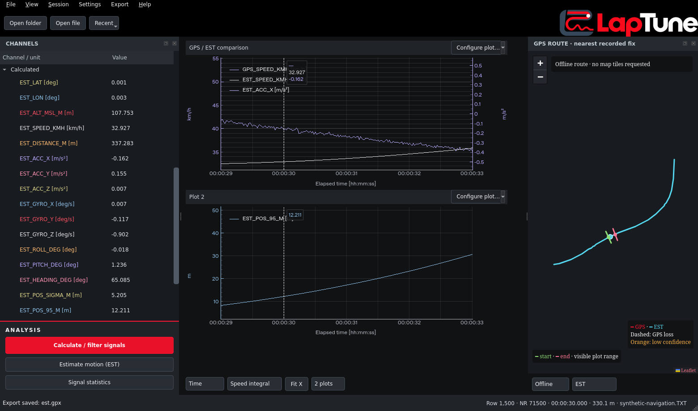

# EST vehicle motion · driving calibration and IMU/GPS fusion

Choose **Estimate motion (EST)…** at the bottom of Channels, or in **Session**.
All outputs are new `EST_…` channels in **Calculated**. Raw `ACC_X/Y/Z`, `GYRO_X/Y/Z`,
`GPS_LAT/LON`, speed, height, raw timestamps and existing distance axes are preserved.
Each estimated channel has a description in Channels/Configure plot tooltips and CSV metadata.



## Use

1. Load a file or folder. Check ACC/GYRO units in the EST dialog: normally g and deg/s for the
   supplied LSM6DS3 logs. Labels in Settings alone do not convert raw values.
2. Calibrate from **All moving GPS segments**, or zoom to a suitable driving fragment and choose
   **Visible plot range**. Drive forward with acceleration/braking and turns or changes of grade.
   No stationary calibration or automatic zero-velocity update is used.
3. Confirm that the segment has negligible mean bank and sideslip. With missing GPS height,
   calibration additionally assumes negligible road grade. A constant straight slope at constant
   speed cannot identify all mounting/bias parameters; insufficient excitation is rejected.
4. Choose **Calculate EST signals**. Calculation runs in a cancellable worker; closing the window
   waits for interruption. Results appear together only after success. Existing plot count and
   assignments stay unchanged. Recalculation replaces only the previous navigation-owned EST
   outputs; any raw or independently calculated channel with a colliding EST name is protected.
5. Use **Configure plot…** to compare raw and estimated channels. A raw ACC in g and EST ACC in
   m/s² get independent axes. Channels can use the existing color, filter and statistics tools.
6. The map gains **GPS + EST / GPS / EST**. GPS remains red, EST is cyan, dead reckoning dashed,
   and low-confidence EST orange. The cursor shows a model uncertainty circle. In EST-only mode,
   viewport markers and map selection follow the estimated trajectory, including GPS outages.
7. **Session > EST calibration and navigation report…** shows calibration residuals, excitation,
   accepted/rejected GPS updates and timing warnings. CSV includes full parameters and descriptions;
   **Export > EST trajectory to GPX…** creates an explicitly labelled estimated track. The original
   **GPS route to GPX…** continues exporting recorded fixes only.

Outputs belong to the loaded session. Reopening a log requires recalculation; they do not silently
become raw measurements or rewrite the TXT file. Previously filtered/calculated channels are not
automatically recalculated when EST is rerun.

## Axes, calibration and propagation

Vehicle axes are right-handed: **X rear, Y right, Z up**; world coordinates are local East/North/Up.
Forward body velocity is approximately `[-u, 0, 0]`. After gravity removal, acceleration is negative
X when accelerating forward, positive X when braking, positive Y towards the right. Positive Z
angular rate means a left turn. Positive pitch means vehicle front up.

The offline calibration reference uses time-aware weighted local quadratic fits to GPS positions,
native horizontal speed and available MSL height. Its reference orientation has rearward X opposite
the 3D direction of travel, horizontal rightward Y, and upward Z; its bank is defined as zero.
Samples below 3 m/s and across GPS gaps are excluded. The dialog's smoothing parameter is a
half-window, normally 2.5 s. The fit requires enough GPS samples on both sides of each reference.

For a forward vehicle without substantial sideslip:

```
v_body = [-u, 0, 0]
a_body = [-du/dt, -u*omega_Z, u*omega_Y]
f_reference = a_body - R_world_from_body.T @ gravity_world
```

Road grade is `atan2(vertical_speed, horizontal_speed)`. MSL height remains separate from WGS84
ellipsoid height. For straight, unbanked travel, specific force along rearward X is
`-du/dt - g*sin(grade)`: climbing gravity is not mistakenly removed as sensor DC bias.

A robust centered Wahba/SVD fit jointly identifies the fixed sensor-to-vehicle rotation and constant
ACC/GYRO biases from moving data. It combines force and angular references, iteratively downweights
outliers, checks excitation and residuals, and constrains rotation determinant to +1. It rejects
unobservable fits instead of selecting an arbitrary mounting orientation. Large residuals produce
warnings. Biases are subsequently refined by the navigation filter.

Navigation uses a **15-error-state multiplicative ESKF**, with position, velocity, SO(3) attitude,
ACC bias and gyro bias. Rotation matrices and exponential-map attitude corrections implement the
same nonsingular attitude state represented by a unit quaternion. Midpoint IMU propagation uses
the actual navigation interval:

```
a_world = R_world_from_body @ (R_body_from_sensor @ f_sensor - bias_acc_body) + gravity_world
p_next = p + v*dt + 0.5*a_world*dt²
v_next = v + a_world*dt
R_next = R @ Exp((omega_body - bias_gyro_body)*dt)
```

Covariance includes continuous acceleration/gyro noise and bias walks, discretized with dt. GPS
position, native speed and available altitude provide gated measurement corrections. Covariance
uses the Joseph update and the attitude-error reset. Defaults for GPS sigma are 5 m horizontal,
10 m vertical and 0.5 m/s speed; these are configurable assumptions, not measured receiver accuracy.

There is **no estimated position before GPS initialization**. Initialization needs valid GPS,
usable forward movement/direction and a baseline exceeding the configured position uncertainty.
During GPS loss only prediction continues and uncertainty grows. Missing IMU, a recording gap over
0.25 s or a hardware-clock reset interrupts the solution; new valid GPS/motion must reinitialize it.
Long GPS rejection sequences also allow explicit reinitialization. Map/GPX segments preserve those
interruptions. Optional soft lateral/vertical vehicle constraints are off by default and suppressed
during stronger turns; leave them off for sideslip, drift or substantial suspension motion.

## Timing and GPS freshness

Navigation uses a **separate integration clock**. The original plotted timeline remains unchanged;
`EST_TIME_S` records the clock actually used in the calculation. Thus existing display corrections
of +1 microsecond are never interpreted as IMU sampling intervals.

Preferred optional logger fields:

| Field | Meaning |
|---|---|
| `T_IMU_US` | Monotonic acquisition time of each IMU sample, microseconds; aliases `T_US`, `IMU_T_US` |
| `GPS_STATE` | `N`: new valid epoch; `R`: repeated stored value; `I`: invalid/unavailable GPS |
| `GPS_FIX_ID` or `GPS_ITOW_MS` | Epoch identity; duplicate epochs are not assimilated again |
| `GPS_NEW`, `GPS_VALID` | Numeric 1/0 alternatives for freshness and validity |

Keep `R` in its own `GPS_STATE` column; numeric measurement fields stay numeric. Flags should
come from receiving a new measurement epoch, including when its values equal the previous epoch.
Messages belonging to the same epoch must not repeatedly mark an old horizontal position as new.
The importer preserves `GPS_STATE` verbatim as a row field and includes it in CSV exports.

Without hardware time, positive recorded time differences are used. Missing spans between plausible
clock anchors are distributed by acquisition count, edge gaps use the observed median interval, and
backward clock steps receive estimated intervals. Positive recording discontinuities remain gaps.
Negative/invalid NR does not create an artificial large interval. Strict mode can reject any estimated
interval. Estimated intervals inflate process noise heuristically and mark affected estimates as
low confidence; this does not establish a calibrated accuracy bound.

Without freshness flags/IDs, observable changes are used conservatively. Coordinate changes update
horizontal position; independent speed/height changes update only those quantities. Identical new
fixes cannot be distinguished from held values. The report explicitly records this limitation.

## Estimated signals

| Channel | Meaning |
|---|---|
| `EST_LAT`, `EST_LON` | Fused/propagated vehicle coordinates [deg] |
| `EST_ALT_MSL_M` | Estimated MSL altitude [m]; unavailable without a measured height reference |
| `EST_SPEED_KMH` | Estimated horizontal speed [km/h] |
| `EST_VEL_X/Y/Z` | Estimated vehicle-frame velocity [m/s]; forward X is negative |
| `EST_DISTANCE_M` | Integral of fused horizontal speed [m], excluding invalid IMU gaps |
| `EST_ACC_X/Y/Z` | Vehicle-frame linear acceleration, bias/gravity removed [m/s²] |
| `EST_GYRO_X/Y/Z` | Vehicle-frame angular rates, bias compensated [deg/s] |
| `EST_ACC_BIAS_X/Y/Z` | Estimated vehicle-frame ACC bias being subtracted [m/s²] |
| `EST_GYRO_BIAS_X/Y/Z` | Estimated vehicle-frame gyro bias being subtracted [deg/s] |
| `EST_ROLL_DEG`, `EST_PITCH_DEG` | Vehicle orientation angles [deg] |
| `EST_HEADING_DEG` | Forward heading clockwise from north, opposite rearward X [deg] |
| `EST_POS_SIGMA_M` | Model horizontal RMS standard uncertainty, sqrt(P_EE + P_NN) |
| `EST_POS_95_M` | Model 95% enclosing radius from the largest horizontal covariance eigenvalue |
| `EST_GPS_AGE_S` | Integration time since the last accepted new horizontal position |
| `EST_NAV_STATUS` | 0 waiting; 1 GPS aided; 2 dead reckoning; 3 low confidence; 4 IMU interruption |
| `EST_TIME_S` | Navigation integration time [s] |
| `EST_TIME_QUALITY` | 0 hardware; 1 logger time; 2 estimated/repaired interval |

Position/motion values remain invalid until navigation initialization and across interruptions.
Diagnostic status/time channels can explain those intervals. Neither raw distance axis is replaced
by `EST_DISTANCE_M`. CSV preserves the shared plotting-row alignment and includes navigation time
as an explicitly selected EST signal. EST GPX includes status, uncertainty, integration time, raw
time and the report as extensions, without manufacturing UTC timestamps during GPS loss.

## Accuracy limits and validation

Single-antenna GPS cannot separate fixed mounting roll from unknown mean bank. Calibration assumes
forward travel and no substantial sideslip. GNSS/IMU are assumed co-located and synchronized at the
logger row; antenna lever arms, measurement latency, IMU scale/nonorthogonality calibration, reverse
gear detection, receiver quality-derived covariance and long-distance Earth-frame corrections are
not modeled. RTS smoothing is a separate optional future step, not part of this implementation.

The model can reduce random GPS noise, reject inconsistent fixes and bridge short outages. It cannot
guarantee removal of persistent GPS bias or reliable positioning through an arbitrarily long outage.
Bias and tilt errors accumulate. Clock estimation and noisy NEO-6 height further limit results.
Use the calibration report and estimated uncertainty alongside the original measurements.

`tools/generate_navigation_demo.py` independently generates a known 3D trajectory, nontrivial mounting,
sensor biases, 50 Hz IMU, 5 Hz GPS and a 7 s outage. Three seeded scenarios in
[benchmarks/navigation.json](benchmarks/navigation.json) recover mounting within 0.43°, reduce
horizontal error at GPS epochs from about 0.21 m RMS to 0.08–0.09 m RMS, and reach maximum outage
errors of 0.22–1.53 m. These intentionally synthetic conditions and offline whole-drive calibration
do **not** establish real NEO-6/LSM6DS3 accuracy.

```
python tools/generate_navigation_demo.py data/generated/navigation.TXT
python -m telemetry_viewer data/generated/navigation.TXT
python tools/benchmark_navigation.py
```

The real Qt check `tools/check_navigation.py` exercises the actual wizard and worker, preservation of
raw arrays and two-plot layouts, mixed-unit EST plots, the real Leaflet trajectory/cursor/range ticks,
CSV/GPX export and cancellation on close. Optional private-log tests are skipped in public CI;
private trajectories are never included in screenshots, benchmarks or fixtures.
The Windows packaging check also runs `--smoke-navigation` in the actual frozen executable,
verifying moving calibration, ESKF execution, GPS-loss output, unchanged raw samples and the
real EST map layer. The same entry point is exercised by the source tests.
